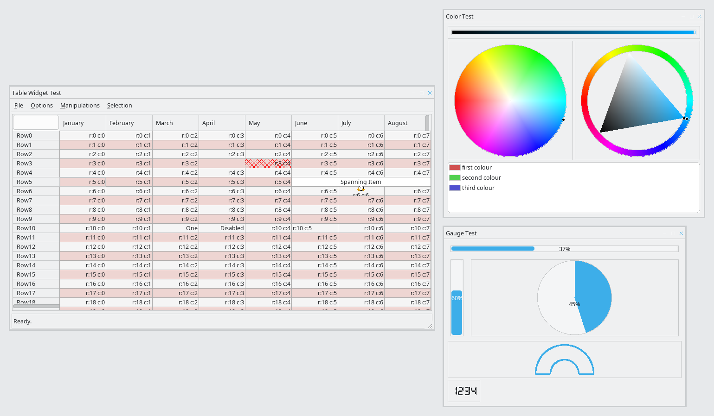
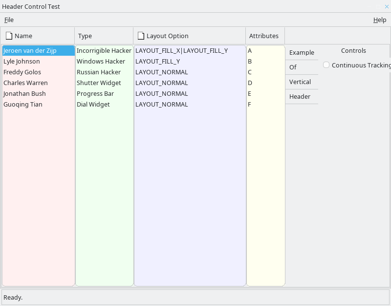
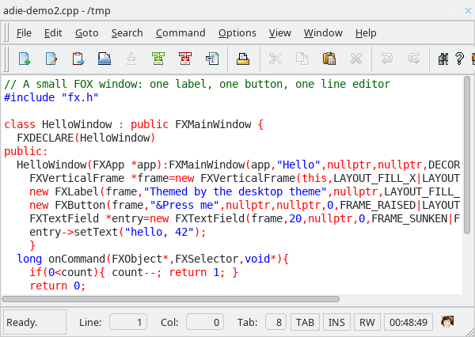
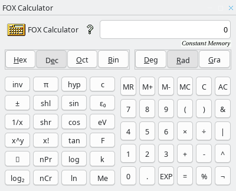
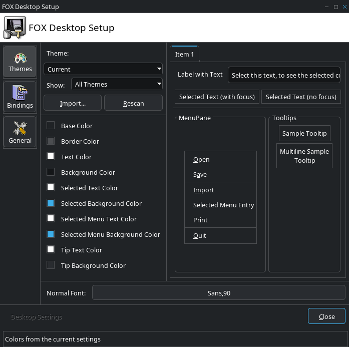
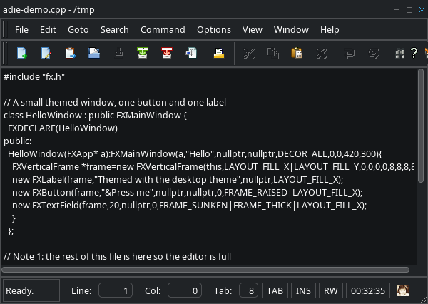
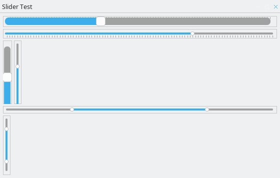
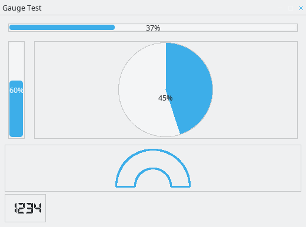
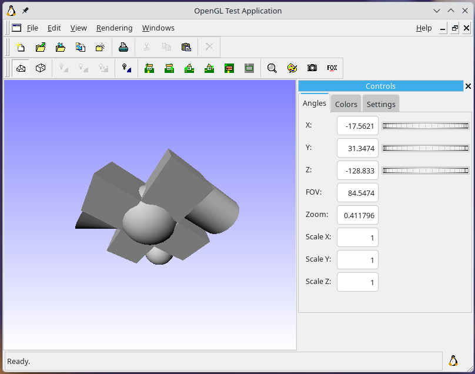
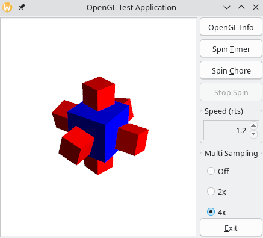

# FOX 2 — a theme experiment

**This is not a fork, and it is not "FOX 2".**

It is a personal test project that takes the [FOX toolkit](https://fox-toolkit.org/)
(release 1.7.95) and tries to teach it to follow the look of the modern desktop:
the same flat surfaces, hairline borders, rounded corners and accent colours that
GTK and Qt applications have had for years.  FOX itself is by
Jeroen van der Zijp, it lives at **[fox-toolkit.org](https://fox-toolkit.org/)**,
and nothing here is official, endorsed or supported by him.



---

## Why

FOX is fast, small and pleasant to write, but it looks like 1995: sunken boxes,
raised buttons, bevels and stipples.  On a modern desktop that is the only reason
a FOX program stands out — the widgets, the logic and the toolkit age just fine.

So the experiment is: **can FOX read the theme the desktop already has, and look
like it belongs, without losing what makes FOX nice?**

## Goals

* **Take the theme from the desktop.**  Instead of inventing a look, read the
  theme that is already installed — a GTK theme, or a small text theme file — and
  use its colours, fonts, spacing and corner radius.
* **Change nothing when no theme is chosen.**  The classic FOX palette must stay
  pixel for pixel the way it was.  Themed mode is something you switch on.
* **Three platforms, one code base.**  Native X11, native Win32, and Wayland
  without going through XWayland.
* **No heavy new dependency.**  If it cannot be done with what FOX already links
  against, it is not done.

## What works today

* **Most of the toolkit is themed** — buttons, entries, lists, trees, tables,
  menus, tabs, scroll bars, sliders, gauges, calendars, colour pickers, rulers,
  dialogs, tool tips, popups and the client side title bar.  The classic palette
  is still exactly there when no theme is selected.
* **Light and dark.**  A dark theme is imported like any other and the whole
  application follows, including menus and tool tips.
* **You can pick an installed theme.**  The control panel lists every GTK theme
  it finds, applies it live, and remembers the choice.
* **It scales.**  High DPI is handled on all three platforms: Windows runs
  per-monitor DPI aware and realises fonts for the monitor a window is on, and a
  scaled theme produces scaled controls, not stretched ones.
* **OpenGL still works on Wayland.**  GL canvases are drawn into Wayland
  subsurfaces, so a 3D application keeps its own fast native surface instead of
  falling back to something slower.
* **It is checked, not just eyeballed.**  A set of automatic checks drives the
  programs, compares frames and fails the build when a piece of old chrome
  sneaks back in — including checks that no classic bevel colour appears in a
  themed window.
* **It stays FOX.**  Same widgets, same API, same style of code.  A FOX program
  gains the theme without being rewritten.

### The same window, two ways

| Classic FOX | With a theme imported from the desktop |
|---|---|
|  |  |

### Applications

| | |
|---|---|
|  |  |
| `adie`, the FOX editor: themed chrome, a monospace editor font and syntax colouring | the calculator, every button rounded and flat |

### Dark themes

The theme is imported, not approximated, so a dark theme changes the surfaces,
the text, the menus and the tool tips together.  The editor's syntax colours are
still its own palette and do not follow yet, so they are left off here.

| | |
|---|---|
|  |  |

### More controls

| | |
|---|---|
|  |  |
|  |  |

### OpenGL on Wayland

| | |
|---|---|
|  |  |
| `glviewer` showing a model, with its own menu, tool bars and a control panel | the OpenGL test scene with its buttons, spinner and radios |

Both are FOX applications running on a Wayland compositor: the 3D scene lives in
its own EGL surface on a subsurface, while the window around it — menus, tool
bars, tabs, sliders, spinners, radios — is themed like everything else, and the
title bar is FOX's own.

## Try it

### Linux — X11 or Wayland

```sh
./scripts/build-fox2-linux.sh --cmake     # X11     -> tmp/build-fox2-linux-cmake/bin
./scripts/build-fox2-wayland.sh           # Wayland -> tmp/build-fox2-wayland/bin

# run any of the small test programs
tmp/build-fox2-linux-cmake/bin/table
tmp/build-fox2-wayland/bin/header
```

### Windows

Two ways, both with MinGW-w64.  The toolchain itself comes from
`scripts/install-cachyos-mingw.sh` on Linux (it installs Wine too, for smoke
tests) or from `scripts/install-msys2-deps.sh` inside MSYS2.

**Cross-compiled on Linux** — the quick way to check the Windows backend, and
the result runs under Wine:

```sh
./scripts/build-fox2-mingw-cross.sh --cmake          # -> tmp/build-fox2-cross-cmake/bin
./scripts/build-fox2-mingw-cross.sh --cmake --run    # build, then run under Wine
```

**Built natively on Windows with MSYS2** — start the **MINGW64** shell, the one
from `C:\msys64\mingw64.exe`, not the plain MSYS shell, because the build needs
the mingw-w64 compiler:

```sh
./scripts/install-msys2-deps.sh                      # once: compilers and libraries
./scripts/build-fox2-mingw.sh --cmake --run          # -> tmp/build-fox2-win-cmake/bin
```

Both scripts take `--fast` to skip the configure step when nothing changed,
`--clean`, `--opengl`, `--debug`/`--release` and `--jobs=N`, and print the same
help with `--help`.

Then pick a theme — the easy way is the control panel, which shows what is
installed and applies it immediately:

```sh
tmp/build-fox2-linux-cmake/bin/ControlPanel
```

or write the choice down where it stays, in your personal FOX settings file:

```sh
mkdir -p ~/.config
cat > ~/.config/fox.rc <<'EOF'
[SETTINGS]
theme=/usr/share/themes/Breeze
EOF
```

`theme=` takes a GTK theme directory, a small text theme file, `classic` for the
old palette, `dark` for a dark interpretation of it, or `auto` to follow the
desktop's light/dark preference.

## Where it stands

This is a playground, not a release: expect rough edges, half-finished widgets
and a few corners of the toolkit that still paint the old way — the specialised
dial and knob controls, for instance.  The popup drop shadow exists on Wayland
and still has to come for X11 and Windows.  The editor's syntax colours are a
palette of their own and have to be chosen for a dark theme by hand.

The technical notes, including which widget is how far along and why some things
are harder than they look, are in [docs/](docs/).

## Credits and licence

* FOX is © Jeroen van der Zijp and lives at <https://fox-toolkit.org/>.  This tree
  is his release 1.7.95 with changes applied, and keeps its licence
  ([LGPL 3](LICENSE)).
* Theme import leans on the work of the GTK and Qt designers whose themes are
  being read — the colours in the screenshots are Breeze's.
