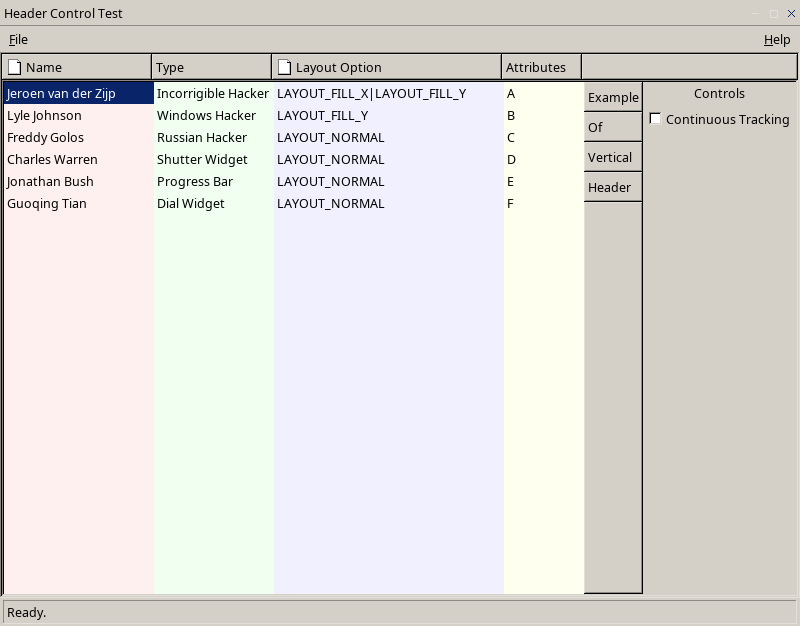
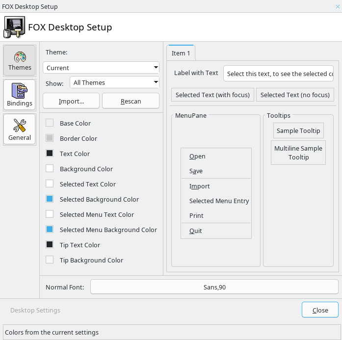
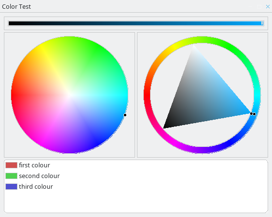

# FOX 2 — a theme experiment

**This is not a fork, and it is not "FOX 2".**

It is a personal test project that takes the [FOX toolkit](https://fox-toolkit.org/)
(release 1.7.95) and tries to teach it to follow the look of the modern desktop:
the same flat surfaces, hairline borders, rounded corners and accent colours that
GTK, KDE and Qt applications have had for years.  FOX itself is by
Jeroen van der Zijp, it lives at **[fox-toolkit.org](https://fox-toolkit.org/)**,
and nothing here is official, endorsed or supported by him.


---

## Why

FOX is fast, small and pleasant to write, but it looks like 1995: sunken boxes,
raised buttons, bevels and stipples.  On a modern desktop that is the only reason
a FOX program stands out — the widgets, the logic and the toolkit age just fine.

So the experiment is: **can FOX read the theme the desktop already has, and look
like it belongs, without losing what makes FOX nice?**

## Goals

* **Take the theme from the desktop.**  Instead of inventing a look, read the
  theme that is already installed — a GTK theme, a KDE colour scheme, or a small
  text theme file — and use its colours, fonts, spacing and corner radius.
* **Change nothing when no theme is chosen.**  The classic FOX palette must stay
  pixel for pixel the way it was.  Themed mode is something you switch on.
* **All three platforms.**  The same code has to work on X11, on Wayland and on
  Windows, with the same result.
* **No heavy new dependency.**  If it cannot be done with what FOX already links
  against, it is not done.

## What works today

* **Most of the toolkit is themed** — buttons, entries, lists, trees, tables,
  menus, tabs, scroll bars, sliders, gauges, calendars, colour pickers, rulers,
  dialogs, tool tips, popups and the client side title bar.  The classic palette
  is still exactly there when no theme is selected.
* **You can pick an installed theme.**  The control panel lists every GTK theme
  and KDE colour scheme it finds, applies it live, and remembers the choice.
* **It scales.**  The theme drives the sizes as well as the colours, so a scaled
  display gets scaled controls, not stretched ones.
* **It is checked, not just eyeballed.**  A set of automatic checks drives the
  programs, compares frames and fails the build when a piece of old chrome
  sneaks back in — including checks that no classic bevel colour appears in a
  themed window.
* **It stays FOX.**  Same widgets, same API, same style of code.  A FOX program
  gains the theme without being rewritten.

### The same window, two ways

| Classic FOX | With a theme imported from the desktop |
|---|---|
|  |  |

### A few controls up close

| | |
|---|---|
|  |  |
|  |  |

## Try it

```sh
# build for your desktop (X11 or Wayland)
./scripts/build-fox2-linux.sh --cmake
./scripts/build-fox2-wayland.sh

# run any of the small test programs
tmp/build-fox2-linux-cmake/bin/table
tmp/build-fox2-wayland/bin/header
```

Then pick a theme — the easy way is the control panel, which shows what is
installed and applies it immediately:

```sh
tmp/build-fox2-linux-cmake/bin/ControlPanel
```

or write the choice down where it stays, in your personal FOX settings file:

```sh
mkdir -p ~/.config
cat > ~/.config/fox.rc <<'EOF'
[SETTINGS]
theme=/usr/share/themes/Breeze
EOF
```

`theme=` takes a GTK theme directory, a KDE colour scheme, a small text theme
file, `classic` for the old palette, `dark` for a dark interpretation of it, or
`auto` to follow the desktop's light/dark preference.

## Where it stands

This is a playground, not a release: expect rough edges, half-finished widgets
and a few corners of the toolkit that still paint the old way — the specialised
dial and knob controls, for instance.  The popup drop shadow exists on Wayland
and still has to come for X11 and Windows.

The technical notes, including which widget is how far along and why some things
are harder than they look, are in [docs/](docs/).

## Credits and licence

* FOX is © Jeroen van der Zijp and lives at <https://fox-toolkit.org/>.  This tree
  is his release 1.7.95 with changes applied, and keeps its licence
  ([LGPL 3](LICENSE)).
* Theme import leans on the work of the GTK, KDE and Qt designers whose themes
  are being read — the colours in the screenshots are Breeze's.
